  

# Blind Spot: Everyday Pakistani Punjabi Words

Muhammad Ramzan — Fatima Fellowship Fall 2026, Technical Challenge

  
  
  
  

## 1. The blind spot

Punjabi is my mother tongue. We speak it at home since my childhood, and it is the main language in my whole area. So I know the meaning of everyday Punjabi words very well.

Punjabi is spoken in two regions: Punjab in Pakistan and Punjab in India. People on both sides speak almost the same words, but the writing is completely different. In Pakistan we write Punjabi in the Shahmukhi script, which looks like Urdu. In India it is written in Gurmukhi, which has its own alphabet. Some words also have a different meaning on each side.

I noticed that when AI models know some Punjabi, they mostly know Indian Punjabi. Many everyday Pakistani Punjabi words are a blind spot for them. The models do not understand these words properly, so they cannot give the right meaning.

## 2. What I tested

- **Model:** [google/gemma-4-E2B-it](https://huggingface.co/google/gemma-4-E2B-it) (Google DeepMind, 2026). I chose it because it was the latest open model I found in the required size range (0.6B to 6B). Google also says it is trained on more than 140 languages.
- **Data:** 40 everyday words that I wrote myself in Pakistani Punjabi (Shahmukhi script). For each word, I also wrote the same thing in Urdu, plus the correct English meaning.
- **Prompt:** the same sentence for every question; only the word changes:
  - `What does the Pakistani Punjabi word "___" mean in English? Answer in one line.`
  - `What does the Urdu word "___" mean in English? Answer in one line.`
- **Setup:** Google Colab (T4 GPU), Hugging Face Transformers, greedy decoding (`do_sample=False`), each question asked separately with no chat history.
- **Scoring:** I checked every answer myself: 1 = correct, 0.5 = partly correct, 0 = wrong.

## 3. Results

| Version | Words | Average score | Correct (1) | Partly correct (0.5) | Wrong (0) |
|---|---|---|---|---|---|
| Pakistani Punjabi | 40 | 18.75% | 4 | 7 | 29 |
| Urdu | 40 | 73.75% | 29 | 1 | 10 |

The gap between Urdu and Punjabi is 55 percentage points.

### What I noticed

While scoring, I saw that most of the time the model did not understand the Punjabi word at all. It got confused, and many times it matched the word with a word from another language and gave that meaning. For some words it directly said that the word is not common or that the meaning depends on the context. When it did try to answer, it had understood the word wrong, so the answer was also wrong. For the same things in Urdu, the model understood most of the words.

Some examples:

| Punjabi word | Correct meaning | Model said |
|---|---|---|
| بھاگوان | Wife | "God" or "Lord" |
| ہندوانہ | Watermelon | something related to India |
| پٹھے | Grass | muscles or strength |
| منجی | Rope-cot | child or son |
| لا ڑہ | Groom | not a standard or commonly recognized phrase |

## 4. Path forward

I think we need a big dataset of Pakistani Punjabi, written in Shahmukhi. We can collect it from the Punjabi regions, for example from how people there use the internet and AI apps in their daily life. Then we can fine-tune models on this dataset. In my opinion, this can solve a big part of this problem.

## 5. Limitations

The model also made some mistakes in Urdu, so it is not perfect in Urdu either. But it is much weaker in Punjabi than in Urdu. Some of my Urdu entries are phrases, not single words. This test has only 40 words and one model, and I scored all the answers myself.

## Files in this repository

- `README.md` — this file
- `banner.svg` — the animated card at the top
- `results_scored.csv` — the 80 questions, model answers, and my scores and notes
- `punjabi_blindspot_eval.ipynb` — the Colab notebook I ran
